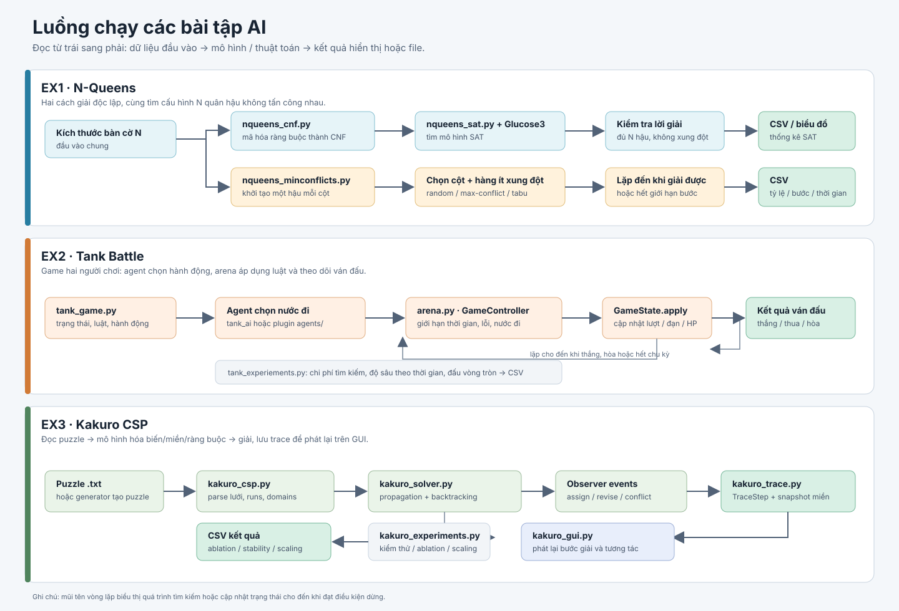

# Tổng quan các bài tập AI

README này tóm tắt các module, dữ liệu và luồng chạy hiện có trong `ex1`, `ex2`, `ex3`. `ex1` giải N-Queens, `ex2` xây dựng Tank Battle với agent có thể thay thế, còn `ex3` mô hình hóa và giải Kakuro bằng CSP.

## Cấu trúc

```text
source/
├── ex1/
│   ├── nqueens_cnf.py
│   ├── nqueens_sat.py
│   ├── nqueens_minconflicts.py
│   └── results_minconflicts.csv
├── ex2/
│   ├── arena.py
│   ├── agent_loader.py
│   ├── agents/                 # agent plugin mẫu và hướng dẫn API
│   ├── tank_game.py
│   ├── tank_ai.py
│   ├── tank_experiements.py
│   ├── tank_gui.py             # hiện chưa có nội dung
│   └── results_*.csv
└── ex3/
    ├── kakuro_csp.py
    ├── kakuro_solver.py
    ├── kakuro_trace.py
    ├── kakuro_gui.py
    ├── kakuro_experiments.py
    ├── generate_puzzle.py
    ├── puzzles/                # puzzle mẫu dạng .txt
    └── results_*.csv
```

## Sơ đồ pipeline



Mũi tên chỉ luồng dữ liệu chính; hai nhánh trong `ex1` là các thuật toán giải độc lập.

## `ex1`: N-Queens

Bài toán đặt `N` quân hậu lên bàn cờ `N x N` sao cho không quân nào ăn được quân nào. Có hai hướng giải trong thư mục: chuyển ràng buộc thành công thức logic CNF rồi dùng SAT solver, hoặc dùng tìm kiếm cục bộ Min-Conflicts.

### [source/ex1/nqueens_cnf.py](source/ex1/nqueens_cnf.py)

Xây dựng mô hình logic CNF cho N-Queens.

- `Board` ánh xạ mỗi ô `(hàng, cột)` thành ID biến mệnh đề và chuyển ngược lại; đồng thời đổi mô hình SAT thành các vị trí quân hậu và in bàn cờ.
- `CNFFormula` lưu các mệnh đề và có thể xuất công thức theo định dạng DIMACS.
- `ConstraintGenerator` sinh ràng buộc: mỗi hàng có ít nhất một hậu và không có hai hậu cùng hàng, cột hoặc đường chéo. Có cách sinh cặp quân tấn công trực tiếp (naive) và cách gom ô theo hàng/cột/đường chéo (grouped) để giảm công việc.
- Khi chạy trực tiếp, chương trình so sánh số mệnh đề của hai cách sinh trên một số kích thước bàn cờ.

Đây là module nền, được `nqueens_sat.py` dùng để tạo công thức và kiểm tra lời giải.

### [source/ex1/nqueens_sat.py](source/ex1/nqueens_sat.py)

Giải N-Queens bằng SAT solver Glucose3 từ thư viện PySAT.

- `SATQueensSolver` tạo CNF, gọi Glucose3, đo riêng thời gian sinh CNF và thời gian giải, rồi chuyển mô hình trả về thành vị trí các quân hậu.
- `is_valid` kiểm tra độc lập rằng lời giải có đủ `N` quân và không có cặp nào tấn công nhau.
- `ExperimentRunner` chạy thử nhiều kích thước bàn cờ, in thống kê, lưu CSV và có thể vẽ đồ thị nếu đã cài `matplotlib`.
- Khi chạy trực tiếp, chương trình in một lời giải cho bàn cờ 8x8, sau đó chạy thí nghiệm và ghi `results_sat.csv` cùng biểu đồ `results_sat.png` vào thư mục làm việc hiện tại.

Phụ thuộc chính: `python-sat`; `matplotlib` chỉ cần cho phần vẽ biểu đồ.

### [source/ex1/nqueens_minconflicts.py](source/ex1/nqueens_minconflicts.py)

Giải N-Queens bằng thuật toán tìm kiếm cục bộ Min-Conflicts, không cần SAT solver.

- Trạng thái lưu một hậu cho mỗi cột; `rows[c]` là hàng của hậu ở cột `c`. Nhờ vậy ràng buộc mỗi cột có đúng một hậu luôn được thỏa mãn.
- `QueensState` duy trì số hậu trên từng hàng và hai hướng đường chéo để tính xung đột nhanh, cập nhật khi di chuyển hậu.
- Các bộ chọn biến gồm chọn ngẫu nhiên một cột đang xung đột, chọn cột có nhiều xung đột nhất, và biến thể chọn xung đột lớn nhất kèm tabu để hạn chế lặp vòng.
- `MinConflictsSolver` tạo trạng thái ban đầu ngẫu nhiên, chọn một cột xung đột rồi chuyển hậu trong cột đó đến hàng ít xung đột nhất; dừng khi tìm được lời giải hoặc đạt giới hạn bước.
- `Experiment` chạy nhiều lần cho từng kích thước và bộ chọn, rồi tổng hợp tỷ lệ thành công, số bước trung bình và thời gian trung bình.
- Khi chạy trực tiếp, chương trình in thử cho `N=8` và chạy thí nghiệm cho các kích thước từ 8 đến 256.

### [results_minconflicts.csv](source/ex1/results_minconflicts.csv)

Kết quả thí nghiệm Min-Conflicts đã được lưu sẵn. Mỗi dòng là một cặp kích thước `N` và thuật toán chọn biến, với các cột:

- `success_rate`: tỷ lệ lần chạy tìm được lời giải.
- `avg_steps`: số bước trung bình.
- `avg_time_s`: thời gian chạy trung bình tính bằng giây.

Dữ liệu hiện có cho `N = 8, 16, 32, 64, 128, 256`, mỗi kích thước so sánh ba bộ chọn. Đây là kết quả đã lưu, không phải file được tự động đọc bởi solver.

## `ex2`: Tank Battle

Bài tập mô hình hóa Tank Battle thành game hai người chơi đối kháng, tổng bằng không, sau đó dùng tìm kiếm cây trò chơi để chọn hành động.

### [tank_game.py](source/ex2/tank_game.py)

Chứa luật chơi và trạng thái game; đây là nền tảng mà agent tìm kiếm dùng.

- Các kiểu `Tank`, `Base`, `Bullet`, `Direction` và `Action` biểu diễn đơn vị, hướng và hành động.
- `GameConfig` định nghĩa kích thước bàn cờ, vị trí ban đầu và tường mặc định đối xứng.
- `GameState` quản lý tường và HP, xe tăng, căn cứ, đạn, lượt chơi và số chu kỳ. Nó cung cấp trạng thái ban đầu, sao chép, kiểm tra nước đi hợp lệ, áp dụng hành động để tạo trạng thái mới, di chuyển đạn/xử lý va chạm, nhận diện kết thúc, tính utility và in bàn cờ dạng ASCII.
- Người chơi MAX là xe tăng của ta, MIN là đối thủ. MAX đi trước; sau lượt MIN thì đạn di chuyển và chu kỳ tăng lên.
- Chạy trực tiếp file sẽ in bàn cờ ban đầu cùng các hành động hợp lệ của MAX.

### [tank_ai.py](source/ex2/tank_ai.py)

Triển khai các agent chọn hành động dựa trên tìm kiếm đối kháng.

- `HeuristicEvaluator` chấm điểm trạng thái không kết thúc dựa trên HP xe tăng/căn cứ, khả năng ngắm bắn, đạn đang bay và khoảng cách tới căn cứ đối thủ.
- `Searcher` thực hiện Minimax, có thể bật cắt tỉa Alpha-Beta và heuristic. Tìm kiếm có thể chạy đến độ sâu cố định hoặc iterative deepening trong giới hạn thời gian; thống kê gồm số node, lá, lần cắt tỉa, độ sâu hoàn tất và thời gian.
- Bốn cấu hình được so sánh: Minimax, Alpha-Beta, Minimax có heuristic, và Minimax có heuristic kèm Alpha-Beta.
- `RandomAgent` chọn ngẫu nhiên một nước hợp lệ; `SearchAgent` dùng cấu hình tìm kiếm đã chọn để ra quyết định.
- Giá trị tìm kiếm được quy đổi theo góc nhìn của người đang đi, nên cùng một loại agent có thể điều khiển cả MAX lẫn MIN.

Module này import luật chơi từ `tank_game.py`.

### [tank_experiements.py](source/ex2/tank_experiements.py)

Tạo tình huống chơi và đánh giá bốn cấu hình tìm kiếm trong ba loại thí nghiệm.

- `make_scenarios` tạo trạng thái ban đầu và các trạng thái giữa trận có thể tái lập bằng seed.
- Thí nghiệm A so sánh số node, thời gian, số lần cắt tỉa ở các độ sâu; đồng thời kiểm tra Alpha-Beta trả cùng giá trị và hành động với Minimax tương ứng.
- Thí nghiệm B đo độ sâu tìm kiếm đạt được dưới một ngân sách thời gian cố định.
- Thí nghiệm C cho các agent đấu vòng tròn từ nhiều khai cuộc và tổng hợp thắng/thua/hòa cùng số chu kỳ trung bình.
- Khi chạy trực tiếp, script ghi `results_cost.csv`, `results_depth_budget.csv` và `results_matches.csv` vào thư mục làm việc hiện tại.

Lưu ý: tên file hiện có là `tank_experiements.py` (thừa chữ `e` so với `experiments`); khi chạy, dùng đúng tên file này.

### `arena.py`, `agent_loader.py` và `agents/`

Các file này bổ sung cách chơi game với agent có sẵn hoặc agent plugin:

- `arena.py` điều khiển một ván người-với-agent hoặc agent-với-agent. Mỗi lượt agent chạy trên bản sao trạng thái trong worker thread; hết thời gian, lỗi hoặc trả sai kiểu hành động thì nước đi được thay bằng `STAY`. Chế độ dòng lệnh có thể đấu hai agent qua nhiều khai cuộc.
- `agent_loader.py` nạp agent từ file `.py`. Plugin có thể cung cấp biến `AGENT`, hàm `create_agent()`, một class có `choose_action`, hoặc hàm `choose_action(state)`; loader kiểm tra agent trước khi dùng.
- `agents/README.md` mô tả API plugin. `greedy_agent.py` là ví dụ chọn bắn khi ngắm trúng, nếu không thì tiến gần căn cứ; `function_agent.py` là ví dụ plugin dạng hàm.
- `tank_gui.py` hiện đang rỗng; giao diện chưa được triển khai trong file này.

Chạy đấu agent từ thư mục `source/ex2`, ví dụ: `python arena.py random hab --games 3`. Có thể thay `random` hoặc `hab` bằng đường dẫn plugin trong `agents/`.

## `ex3`: Kakuro bằng CSP

Kakuro được biểu diễn thành bài toán thỏa mãn ràng buộc (CSP): mỗi ô trắng là một biến có miền chữ số 1-9; mỗi dãy ngang/dọc phải có tổng đúng với gợi ý và không lặp chữ số.

### Các module chính

- `kakuro_csp.py` đọc lưới từ văn bản, tìm các dãy ràng buộc (`Run`), tạo miền giá trị và quan hệ láng giềng. `KakuroCSP.is_solution` kiểm tra nghiệm; `statistics` thống kê kích thước mô hình.
- `kakuro_solver.py` giải CSP bằng lan truyền ràng buộc và quay lui. Có thể bật/tắt lọc miền, MRV, Degree, LCV; hỗ trợ giới hạn node, khởi động lại ngẫu nhiên và đếm nghiệm. `SolverStats` lưu node, backtrack, revise và thời gian.
- `kakuro_trace.py` nhận sự kiện từ solver qua observer và lưu snapshot miền giá trị trong từng `TraceStep`. Ba preset cho phép so sánh cấu hình đầy đủ, chỉ propagation, hoặc backtracking thuần.
- `kakuro_gui.py` dùng PyGame để xem từng bước giải, tua timeline, xem miền của ô, chuyển preset, nạp puzzle hoặc sinh puzzle mới.
- `generate_puzzle.py` tạo Kakuro từ mẫu ô trắng/đen và sinh lời giải đã biết; `random_pattern` tạo mẫu ngẫu nhiên với các dãy có độ dài hợp lệ.
- `kakuro_experiments.py` chạy kiểm tra tính đúng/duy nhất (A), so sánh kỹ thuật (B), độ ổn định qua nhiều seed (C), và khả năng mở rộng theo kích thước (D). Kết quả được lưu thành `results_ablation.csv`, `results_stability.csv` và `results_scaling.csv` (khi chạy D).

### Dữ liệu và cách chạy

Thư mục `puzzles/` có `demo_6x5.txt`, `demo_backtracking.txt` và `complex_9x9.txt`. Định dạng dùng `.` cho ô trắng, `#` cho ô đen, và `down\\across` cho gợi ý tổng.

Chạy từ thư mục `source/ex3` để đường dẫn puzzle và file kết quả khớp mặc định:

```bash
python kakuro_gui.py
python kakuro_solver.py puzzles/complex_9x9.txt
python kakuro_experiments.py A B C D
```

GUI cần `pygame`; `kakuro_solver.py` và `kakuro_experiments.py` chỉ dùng thư viện chuẩn của Python.

## Quan hệ giữa các file

```text
ex1:
nqueens_cnf.py ──> nqueens_sat.py ──> kiểm tra nghiệm ──> CSV/biểu đồ
nqueens_minconflicts.py ────────────> results_minconflicts.csv

ex2:
tank_game.py ──> tank_ai.py / agent_loader.py ──> arena.py ──> ván đấu
    └────────────────────── tank_experiements.py ──> các file CSV thí nghiệm

ex3:
puzzles/ ──> kakuro_csp.py ──> kakuro_solver.py ──> nghiệm
                      └─> kakuro_trace.py ──> kakuro_gui.py
    kakuro_experiments.py ──> CSV kiểm thử / so sánh
```

Với `ex1`, chạy từ thư mục gốc repo để import module CNF hoạt động; `ex2` và `ex3` nên chạy từ thư mục bài tập để đường dẫn plugin, puzzle và file kết quả khớp mặc định.

```bash
python -m source.ex1.nqueens_sat
python source/ex1/nqueens_minconflicts.py
```

## Tra cứu các hàm

Mỗi dòng nêu công dụng và điểm quan trọng nhất của hàm. Các phương thức khởi tạo (`__init__`) dùng để thiết lập dữ liệu ban đầu cho lớp.

### [ex1/nqueens_cnf.py](source/ex1/nqueens_cnf.py)

| Hàm | Công dụng và điểm cần nhớ |
|---|---|
| `Board.__init__` | Tạo bàn cờ kích thước `N`; từ chối `N < 1`. |
| `Board.var` | Đổi tọa độ ô thành ID biến SAT, bắt đầu từ 1. |
| `Board.square` | Đổi ID biến SAT ngược thành tọa độ ô. |
| `Board.num_vars` | Trả về tổng số biến, bằng `N x N`. |
| `Board.squares` | Liệt kê toàn bộ ô trên bàn cờ. |
| `Board.model_to_queens` | Lấy các biến dương trong mô hình SAT và đổi thành vị trí hậu. |
| `Board.render` | In lời giải thành bàn cờ, `Q` là hậu và `.` là ô trống. |
| `CNFFormula.__init__` | Tạo danh sách rỗng để lưu các mệnh đề. |
| `CNFFormula.add` | Thêm một mệnh đề vào công thức CNF. |
| `CNFFormula.__len__` | Trả về số mệnh đề hiện có. |
| `CNFFormula.__iter__` | Cho phép duyệt lần lượt các mệnh đề. |
| `CNFFormula.to_dimacs` | Xuất CNF theo DIMACS để dùng với SAT solver. |
| `ConstraintGenerator.__init__` | Gắn bộ sinh ràng buộc với bàn cờ cần xét. |
| `ConstraintGenerator.attacks` | Kiểm tra hai ô khác nhau có cùng hàng, cột hoặc đường chéo không. |
| `ConstraintGenerator.attacking_pairs_naive` | Tìm cặp ô tấn công bằng cách kiểm tra mọi cặp; đơn giản nhưng chậm hơn. |
| `ConstraintGenerator.attacking_pairs_grouped` | Gom ô theo hàng, cột và đường chéo để tạo cặp tấn công hiệu quả hơn. |
| `ConstraintGenerator.at_least_one_per_row` | Tạo mệnh đề yêu cầu mỗi hàng có ít nhất một hậu. |
| `ConstraintGenerator.at_most_one_clauses` | Tạo mệnh đề cấm đặt hậu đồng thời ở hai ô tấn công nhau. |
| `ConstraintGenerator.generate` | Kết hợp các ràng buộc thành CNF; mặc định dùng cách gom nhóm tối ưu. |
| `ConstraintGenerator.expected_clause_count` | Tính số mệnh đề dự kiến để đối chiếu kết quả sinh CNF. |

### [ex1/nqueens_sat.py](source/ex1/nqueens_sat.py)

| Hàm | Công dụng và điểm cần nhớ |
|---|---|
| `SATQueensSolver.__init__` | Chuẩn bị bàn cờ, bộ sinh CNF và các biến ghi thời gian. |
| `SATQueensSolver.build` | Sinh CNF và đo riêng thời gian tạo công thức. |
| `SATQueensSolver.solve` | Dùng Glucose3 tìm lời giải; tự gọi `build` nếu CNF chưa có, trả `None` nếu vô nghiệm. |
| `SATQueensSolver.is_valid` | Kiểm tra độc lập số lượng hậu và các cặp xung đột trong lời giải. |
| `ExperimentRunner.__init__` | Lưu các kích thước bàn cờ cần chạy và nơi tích lũy kết quả. |
| `ExperimentRunner.run` | Chạy solver cho từng kích thước, ghi số biến, số mệnh đề, thời gian và tính hợp lệ. |
| `ExperimentRunner.save_csv` | Ghi kết quả thí nghiệm ra CSV. |
| `ExperimentRunner.plot` | Vẽ đồ thị kích thước CNF và thời gian chạy; cần `matplotlib`. |

### [ex1/nqueens_minconflicts.py](source/ex1/nqueens_minconflicts.py)

| Hàm | Công dụng và điểm cần nhớ |
|---|---|
| `QueensState.__init__` | Tạo trạng thái và các bộ đếm hậu theo hàng, đường chéo để tính nhanh xung đột. |
| `QueensState._add` | Cập nhật các bộ đếm khi thêm hoặc bỏ một hậu. |
| `QueensState.conflicts` | Đếm số hậu xung đột nếu một hậu ở cột, hàng chỉ định; loại phần đóng góp của chính nó. |
| `QueensState.move` | Chuyển hậu trong một cột và cập nhật bộ đếm tương ứng. |
| `QueensState.conflicted_columns` | Trả về các cột có hậu đang bị xung đột. |
| `QueensState.total_conflicts` | Tính tổng số cặp xung đột trên bàn cờ. |
| `VariableSelector.reset` | Đặt lại trạng thái của bộ chọn trước mỗi lần giải; lớp gốc không làm gì. |
| `VariableSelector.select` | Giao diện để lớp con chọn cột xung đột cần sửa. |
| `RandomSelector.select` | Chọn ngẫu nhiên một cột đang xung đột. |
| `MaxConflictSelector.select` | Chọn cột có nhiều xung đột nhất; chọn ngẫu nhiên nếu hòa. |
| `MaxConflictTabuSelector.__init__` | Đặt thời gian cấm chọn lại một cột vừa sửa (tabu tenure). |
| `MaxConflictTabuSelector.reset` | Xóa lịch sử tabu và đặt lại số bước cho lần chạy mới. |
| `MaxConflictTabuSelector.select` | Chọn cột xung đột lớn nhất chưa bị cấm; dùng các cột xung đột làm dự phòng nếu cần. |
| `MinConflictsSolver.__init__` | Thiết lập kích thước, bộ chọn, giới hạn bước và bộ sinh số ngẫu nhiên. |
| `MinConflictsSolver.random_initial` | Tạo trạng thái ban đầu với một hậu ngẫu nhiên trong mỗi cột. |
| `MinConflictsSolver.best_value` | Chọn hàng có ít xung đột nhất cho hậu ở cột đã chọn; hòa thì chọn ngẫu nhiên. |
| `MinConflictsSolver.solve` | Lặp việc chọn cột và chuyển hậu đến khi hết xung đột hoặc chạm giới hạn bước. |
| `Experiment.__init__` | Thiết lập kích thước, số lần thử và các bộ chọn cần so sánh. |
| `Experiment.run` | Chạy nhiều lần cho từng cấu hình, tính tỷ lệ thành công, số bước và thời gian trung bình. |
| `Experiment.save_csv` | Lưu bảng kết quả Min-Conflicts ra CSV. |

### [ex2/tank_game.py](source/ex2/tank_game.py)

| Hàm | Công dụng và điểm cần nhớ |
|---|---|
| `GameConfig.__init__` | Thiết lập kích thước bàn, tường, vị trí xe tăng và căn cứ; có giá trị mặc định. |
| `GameConfig._default_walls` | Tạo bố cục tường đối xứng để hai bên có điều kiện công bằng. |
| `GameState.__init__` | Lưu bản đồ, đơn vị, đạn, người chơi tới lượt và số chu kỳ. |
| `GameState.initial` | Tạo trạng thái bắt đầu từ cấu hình, hoặc dùng bản đồ mặc định. |
| `GameState.copy` | Sao chép trạng thái cùng các đối tượng game để nước đi không sửa trạng thái cũ. |
| `GameState.in_bounds` | Kiểm tra tọa độ có nằm trong bàn cờ không. |
| `GameState.is_free` | Kiểm tra ô có thể cho xe tăng đi vào: trong bàn, không có tường, xe tăng hay căn cứ. |
| `GameState.has_bullet_in_flight` | Kiểm tra người chơi đã có đạn đang bay chưa. |
| `GameState.legal_actions` | Liệt kê hành động hợp lệ; luôn có `STAY`, và chỉ cho bắn khi chưa có đạn bay. |
| `GameState.apply` | Áp dụng hành động lên bản sao; sau lượt MIN thì cập nhật đạn và tăng chu kỳ. |
| `GameState._move_bullets` | Di chuyển đạn tối đa 3 ô, xử lý va chạm và sát thương rồi loại đạn đã trúng. |
| `GameState._destroyed` | Kiểm tra xe tăng hoặc căn cứ của một bên đã hết HP chưa. |
| `GameState.is_terminal` | Kiểm tra game kết thúc sau một chu kỳ, khi có bên bị hạ hoặc hết giới hạn chu kỳ. |
| `GameState.utility` | Tính điểm kết quả từ góc nhìn MAX; thắng sớm có điểm cao hơn, hòa bằng 0. |
| `GameState.key` | Tạo biểu diễn có thể băm của trạng thái để nhận diện trạng thái trùng. |
| `GameState.render` | Chuyển trạng thái thành bàn cờ ASCII kèm HP và số chu kỳ. |

### [ex2/tank_ai.py](source/ex2/tank_ai.py)

| Hàm | Công dụng và điểm cần nhớ |
|---|---|
| `first_hit` | Tìm vật thể đầu tiên trên đường bắn; trả về `None` nếu đạn đi ra ngoài bàn. |
| `HeuristicEvaluator.__init__` | Thiết lập trọng số chấm điểm, cho phép thay một số trọng số mặc định. |
| `HeuristicEvaluator._aim` | Ước lượng khả năng ngắm trúng xe tăng hoặc căn cứ đối phương. |
| `HeuristicEvaluator.evaluate` | Chấm trạng thái theo chênh lệch HP, khả năng bắn, đạn đang bay và khoảng cách; giới hạn điểm trong khoảng `-900..900`. |
| `Searcher.__init__` | Thiết lập độ sâu, cắt tỉa Alpha-Beta, heuristic và bộ thống kê. |
| `Searcher.ordered_actions` | Sắp thứ tự hành động để tìm nước bắn/tiến gần mục tiêu sớm; hàm phụ `key` xếp hạng từng nước. |
| `Searcher._value` | Tìm điểm Minimax đệ quy; có thể dừng theo thời hạn và cắt nhánh khi Alpha-Beta bật. |
| `Searcher._root` | Duyệt các nước đi đầu tiên để chọn hành động có giá trị tốt nhất. |
| `Searcher.search` | Chạy tìm kiếm và trả hành động cùng thống kê; có giới hạn thời gian thì dùng iterative deepening. |
| `Agent.choose_action` | Giao diện bắt buộc cho agent chọn nước đi theo lượt hiện tại. |
| `RandomAgent.__init__` | Tạo bộ sinh số ngẫu nhiên, có thể cố định seed. |
| `RandomAgent.choose_action` | Chọn ngẫu nhiên một nước hợp lệ. |
| `SearchAgent.__init__` | Tạo searcher theo một trong bốn cấu hình, độ sâu và giới hạn thời gian. |
| `SearchAgent.choose_action` | Tìm nước đi bằng searcher và lưu thống kê của lần tìm gần nhất. |

### [ex2/tank_experiements.py](source/ex2/tank_experiements.py)

| Hàm | Công dụng và điểm cần nhớ |
|---|---|
| `make_scenarios` | Tạo trạng thái ban đầu và các trạng thái giữa trận có thể tái lập bằng seed. |
| `write_csv` | Ghi danh sách kết quả ra CSV; không tạo file nếu danh sách rỗng. |
| `experiment_cost` | So sánh số node, thời gian và lần cắt nhánh giữa các cấu hình; kiểm tra Alpha-Beta cho cùng kết quả với Minimax. |
| `experiment_depth_budget` | Đo độ sâu tìm kiếm đạt được dưới các ngân sách thời gian khác nhau. |
| `play_match` | Chạy một ván giữa hai agent, trả kết quả thắng/thua/hòa và số chu kỳ. |
| `openings` | Tạo các thế khai cuộc ngẫu nhiên ngắn để dùng khi đấu thử. |
| `experiment_matches` | Cho các cấu hình đấu vòng tròn từ nhiều khai cuộc và tổng hợp kết quả. |

### API các file mới của `ex2`

| File / hàm chính | Công dụng và điểm cần nhớ |
|---|---|
| `arena.py: GameController.update` | Chạy agent nền và áp dụng kết quả khi sẵn sàng; timeout, lỗi hoặc hành động sai đều thành `STAY`. |
| `arena.py: GameController.submit_human_action` | Nhận nước đi nếu đúng lượt và đúng kiểu `Action`. |
| `arena.py: run_match` | Chạy ván không giao diện đến khi kết thúc hoặc đạt giới hạn chu kỳ. |
| `arena.py: random_openings`, `head_to_head` | Tạo khai cuộc và đấu hai agent, đổi bên rồi tổng hợp thống kê. |
| `agent_loader.py: load_agent_from_file` | Nạp plugin theo một trong bốn kiểu API và chạy thử để xác thực. |
| `agent_loader.py: discover_agent_files` | Tìm plugin `.py` trong `agents/`, bỏ qua tên bắt đầu bằng `_`. |
| `agent_loader.py: builtin_specs`, `file_spec`, `all_specs` | Tạo danh sách agent có sẵn và plugin cho menu chọn người chơi. |
| `agents/greedy_agent.py: GreedyAgent.choose_action` | Bắn nếu ngắm trúng mục tiêu; nếu không thì chọn bước tiến gần căn cứ địch. |
| `agents/function_agent.py: choose_action` | Ví dụ plugin dạng hàm, chọn nước hợp lệ và đôi khi ưu tiên bắn. |

### API chính của `ex3`

| File / hàm chính | Công dụng và điểm cần nhớ |
|---|---|
| `kakuro_csp.py: KakuroPuzzle.from_text` | Đọc lưới và kiểm tra cú pháp clue. |
| `kakuro_csp.py: KakuroPuzzle._extract_runs` | Tạo các dãy ngang/dọc có ràng buộc tổng từ clue. |
| `kakuro_csp.py: Run.combos`, `Run.consistent` | Sinh tổ hợp số đúng tổng và kiểm tra không lặp/tổng còn khả thi. |
| `kakuro_csp.py: KakuroCSP.__init__` | Tạo biến, miền, runs-of và láng giềng; có thể lọc miền ban đầu. |
| `kakuro_csp.py: KakuroCSP.is_solution`, `statistics` | Xác nhận nghiệm và thống kê kích thước CSP. |
| `kakuro_solver.py: KakuroSolver._propagate` | Lọc ràng buộc đến khi ổn định hoặc phát hiện mâu thuẫn. |
| `kakuro_solver.py: KakuroSolver._select`, `_order_values` | Chọn biến theo MRV/Degree và giá trị theo LCV nếu bật. |
| `kakuro_solver.py: KakuroSolver.solve` | Tìm một nghiệm, tôn trọng giới hạn node và lưu thống kê. |
| `kakuro_solver.py: KakuroSolver.solve_with_restarts` | Thử lại với seed mới và giới hạn node tăng dần. |
| `kakuro_solver.py: KakuroSolver.count_solutions` | Đếm tối đa `limit` nghiệm; dừng ở 2 thường đủ kiểm tra tính duy nhất. |
| `kakuro_trace.py: TraceRecorder.observe` | Chuyển sự kiện solver thành bước trace kèm snapshot miền và trạng thái gán. |
| `kakuro_trace.py: build_trace` | Tạo CSP, recorder và solver; trả chuỗi bước để GUI phát lại. |
| `generate_puzzle.py: generate` | Sinh puzzle cùng lời giải đã biết từ mẫu ô trắng/đen. |
| `generate_puzzle.py: random_pattern` | Tạo mẫu ngẫu nhiên và sửa dãy có độ dài không hợp lệ. |
| `kakuro_experiments.py: verify_independent` | Kiểm tra nghiệm trực tiếp từ văn bản puzzle, không dựa vào lớp CSP. |
| `kakuro_experiments.py: experiment_correctness` | Kiểm tra nghiệm, tính duy nhất và kết quả giữa các cấu hình. |
| `kakuro_experiments.py: experiment_ablation`, `experiment_stability`, `experiment_scaling` | So sánh kỹ thuật, độ ổn định theo seed và khả năng giải puzzle lớn hơn. |
| `kakuro_gui.py: KakuroApp.handle`, `update`, `draw` | Xử lý thao tác, cập nhật phát lại và vẽ giao diện. |
| `kakuro_gui.py: main` | Nạp puzzle và chạy vòng lặp PyGame. |

### Dữ liệu kết quả và file chưa triển khai

Các file `.csv` trong `ex1`, `ex2` và `ex3` là kết quả đã lưu, không phải đầu vào solver tự đọc. `source/ex2/tank_gui.py` hiện để trống; phần điều khiển agent và đấu giải nằm trong `arena.py`.